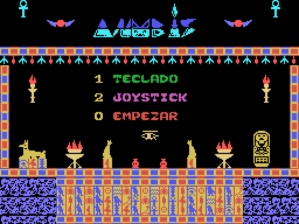

# ANUBIS — juego retro para MSX y ZX Spectrum 48K

Juego MSX *Anubis*: Ayuda a nuestro intrépido aventurero a explorar un intrincado laberinto en un templo egipcio olvidado en la noche de los tiempos.
Conversión para ZX Spectrum 48K y una versión web jugable en el navegador.

<p align="center"> <a href="https://rpdaniels.github.io/Anubis/web/index.html">  </a> </p> <p align="center"> <a href="https://rpdaniels.github.io/Anubis/web/index.html"><b>▶ Jugar <b></a> </p>

## Contenido del paquete

| Carpeta             | Qué hay                                                                     |
| ------------------- | --------------------------------------------------------------------------- |
| `msx/`              | `ANUBIS_EGIPTO.cas` (cinta) y `ANUBIS_EGIPTO.rom` (cartucho de 32 KB)       |
| `spectrum/`         | `ANUBIS_ZX.z80` (snapshot 48K) y `ANUBIS_ZX.tap` (cinta con cargador BASIC) |
| `web/`              | Versión jugable en el navegador (WebMSX + JSSpeccy). Ver `web/LEEME.txt`    |
| `fuentes/msx/`      | Herramientas Python que generan la versión MSX (CAS y ROM)                  |
| `fuentes/spectrum/` | Capa de compatibilidad (HAL) y generadores del Spectrum                     |
| `fuentes/pruebas/`  | Scripts de prueba con openMSX y simulador Spectrum                          |
| `docs/`             | Mapa completo del laberinto y capturas                                      |

## Cómo jugar

- **Menú:** `1` teclado, `2` joystick, `0` empezar. La melodía del título suena entera antes de que el menú responda.
- **Mover:** cursores (en Spectrum también `Q` `A` `O` `P` o `5` `6` `7` `8`, y joystick Kempston con la opción 2).
  El explorador lleva un jet pack para subir por los pozos.
- **Objetos:** escarabajo verde = +25 puntos; ankh = +1 vida. Se empieza con 10 vidas.

## Cargar en máquinas reales y emuladores

**MSX**
- Cinta: `BLOAD"CAS:",R` con `ANUBIS_EGIPTO.cas` (openMSX, blueMSX, WebMSX con BIOS de MSX).
  Para un MSX real, convierte el CAS a audio con `python3 fuentes/msx/cas2wav.py ANUBIS_EGIPTO.cas anubis.wav`.
- Cartucho: `ANUBIS_EGIPTO.rom` arranca solo (también con C-BIOS y en cartuchos flash).

**ZX Spectrum 48K**
- `ANUBIS_ZX.z80`: snapshot comprimido (Fuse, JSSpeccy, ZEsarUX, SpecEmu…).
- `ANUBIS_ZX.tap`: cinta con cargador (`LOAD ""`); válida también para cargar en una máquina real con un reproductor de TAP.

## Construir desde las fuentes

Requisitos: Python 3 con Pillow y numpy, y el ensamblador Z80 `pasmo` (`apt install pasmo`).
Opcional para pruebas: openMSX con C-BIOS, xvfb y el módulo Python `z80`.

```
cd fuentes/msx
# orig.cas es el CAS original del juego (incluido)
python3 extract.py          # game.bin (binario original &H8500-&HF310)
python3 mkmons.py           # anubis_new.bin + ANUBIS_EGIPTO.cas
python3 mkrom.py            # ANUBIS_EGIPTO.rom (cartucho)
python3 mapa.py             # mapa_laberinto.png (opcional)

cp ../spectrum/*.py .       # la conversión usa anubis_new.bin y mons.sym
python3 spectrum.py         # ANUBIS_ZX.tap
python3 makez80.py          # ANUBIS_ZX.z80
```

### Fuentes MSX

| Fichero                      | Contenido                                                                                                   |
| ---------------------------- | ----------------------------------------------------------------------------------------------------------- |
| `extract.py`                 | Extrae `game.bin` del CAS original                                                                          |
| `art.py`                     | Tiles (cenefas, jeroglíficos, objetos, loto gigante, ondas, telarañas, letras de color) y colores por grupo |
| `rooms.py`, `render.py`      | Mini-intérprete de las rutinas de dibujo y renderizador de VRAM a PNG                                       |
| `sim.py`                     | Modelo Python del pase de decoración (cenefas, techos, lotos, estilos de suelo por sala)                    |
| `gen.py`                     | Colocación de objetos por sala, salas temáticas (`THEMES`), recogibles múltiples, loto en la 240            |
| `build.py`                   | Aplica tiles y colores y retoca plantillas y marcador                                                       |
| `make.py`                    | Rutina Z80 de decoración, listas por sala, despachador de rutinas originales, título; empaqueta el CAS      |
| `title.py`                   | Decoración de la pantalla de título                                                                         |
| `monsters.py`                | Sprites (serpiente, escorpión, momia, araña, murciélago, gota), patrullas, colocación de recogibles         |
| `mkmons.py`                  | Código Z80 de monstruos, vidas, puntos, objetos, sonidos PSG, muerte, modos 3/4/5, loto y pantallas finales |
| `ending.py`, `ending_art.py` | Pantallas finales con Anubis grande (llegada al loto y fin de partida)                                      |
| `mkrom.py`                   | Versión cartucho de 32 KB con cargador                                                                      |
| `mapa.py`                    | Mapa completo del laberinto (alcance con jet pack, camino más corto al loto)                                |
| `cas2wav.py`                 | Conversor CAS a WAV (1200 baudios)                                                                          |
| `charset.py`                 | Volcado del juego de caracteres a PNG                                                                       |

### Fuentes Spectrum

| Fichero       | Contenido                                                                                                                                                                                                                                                                                      |
| ------------- | ---------------------------------------------------------------------------------------------------------------------------------------------------------------------------------------------------------------------------------------------------------------------------------------------- |
| `spectrum.py` | HAL en F400: VRAM en sombra (6000) volcada a la pantalla del Spectrum, sprites por software, teclado/Kempston, temporizador IM2, emulación de los sonidos del PSG en el altavoz (motor de dos voces) y melodía del título a dos canales; parchea las llamadas a la BIOS del MSX; genera el TAP |
| `makez80.py`  | Snapshot `.z80` versión 1 comprimido                                                                                                                                                                                                                                                           |
| `zxsim.py`    | Arnés mínimo de Spectrum 48K para pruebas sin ROM                                                                                                                                                                                                                                              |

## Notas técnicas

- **Colisiones:** el juego solo lee 4 casillas de la tabla de nombres: (11,13), (11,18), (6,16) y (16,16).
  Toda la decoración las respeta.
- **Pantalla:** 3 franjas de plantillas (C500-CA3F) más una rutina opcional por sala en D5C0+16·sala. Los huecos vacíos de esa tabla se reutilizan como memoria libre.
- **Memoria de los añadidos (MSX):** 
	- 87D0-8B40 datos de monstruos · 
	- 8D90-9C04 decoración (buffer 9D00-9FFF) ·   
	- A10F-A224, B898-BB34, BBDD-BDDC código de monstruos y objetos · A400-A6CC título ·
	  D610-D6C0 texto de fin de partida y sonido de daño · D720-D790 sonidos · D7E0-D8A0 muerte ·
	  D900-DC00 cambio de sala y recogibles · DC10-DE40 modo 5 y loto · DE50-DED0 variables ·
	  DEE0-DFF0 cuenta atrás · E000-E5C0 pantallas finales.
- **Sonido MSX:** arpegio de Do mayor al coger objetos; dos tonos graves a un semitono al perder vida; barrido de agudo a grave al morir. Todo pasa por `PSGW`, `WAITJ` y `PSGDLY`, que el Spectrum sustituye.
- **Spectrum:** el motor de altavoz alterna las dos voces en cada muestra (unos 25 kHz), lo que permite oír a la vez
  el arpegio y la melodía del título.

## Créditos

- Juego original *Anubis* para MSX; ampliación y conversión: Rafael y Pablo Pérez Daniëls, con ayuda de Claude.
- Versión web: WebMSX 6.0.8 (C-BIOS) de Paulo Augusto Peccin y JSSpeccy 3.2 de Matt Westcott (GPL v3).
